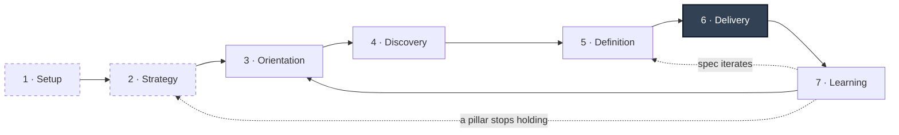

# Solo Builder OS

[](https://github.com/aymzzz-ai/Solo-Builder-OS/actions/workflows/test.yml)

**This project is an operating system for product builders who ship software with agentic tools.** It acts as the connective tissue around your coding agents, supporting your workflow end to end: strategy, prioritization, validation, specs, build agent handoff, and the post-ship review that helps you iterate in future sprints. 

Built to run in Claude Code, it integrates with Replit or Lovable for building, and Linear or GitHub to track the work.

The system connects and holds your product content in a central markdown repository that you own, acting as your source of truth for: your strategy, the decisions and the alternatives you rejected, the specs, what you built, and what you learned during and after each cycle. It answers your questions from that record, with a link to the page behind every claim, and explicitly tells you if something was never logged rather than attempt to fill the gaps. Before you build, it pressure-tests product bets against five reviewer lenses with a go/no-go decision gate.

Your attention goes to the calls that need you: what is worth building, why, and whether it worked.

Your agents get everything else: the context, the specs, and the acceptance criteria to build it right the first time.

---

## Table of Contents

[Why it exists](#why-it-exists) · [The workflow loop](#the-workflow-loop) · [Install](#install) · [Run](#run) · [Documentation](#documentation) · [What's coming](#whats-coming) · [License](#license)

---

## Why it exists

> [!NOTE]
> This repo is a **template**. It ships empty on purpose and is intended for one product per instance. The operating system becomes tailored to that product after your first run of `/onboard`.

Agents changed what one person can ship. Writing code stopped being the bottleneck of
building products, and solo builders can now launch a real product end to end, with the
delivery capacity that used to take a team.

That shifts where your time goes. The judgment calls become the job: deciding what's
worth building, specifying it precisely enough for coding agents to build from, and
holding the reasoning behind both so the next decision starts from the last one.

Those are the parts that compound. A decision you can find again is worth more than one
you remake from scratch. A spec your agents build right the first time is worth more
than three rounds of correction. Context that survives the session is what turns a
string of builds into a product.

So it keeps that context where you can check it: plain markdown in a git repo. When you
hand it content, the full original text gets saved to a dated file first, and that file
is never edited again. Everything above it is summary: wiki pages the OS writes and
rewrites freely, each one citing the captured text behind it. Which means you can open
the original and check what it tells you, even after the URL it came from has died. It
also means text from outside is only ever quoted as data, never followed as instructions.
The files sit on your disk and stay readable whether or not any of this is running.

| Built for you if you | What tends to slip without it |
|:--|:--|
| Run one product on your own and delegate delivery to coding agents | Context between agent sessions |
| Already live in a terminal and use Claude Code | The docs, once the build outruns them |
| Want to interrogate old decisions and specs months later | The *why* behind a call, and the alternatives you rejected |
| Want to own plain files you can read and search yourself | Specs drifting quietly out of sync |

---

## The workflow loop



Each step below is a command you run in Claude Code, and every one is human-in-the-loop by design so nothing is committed anywhere without your explicit approval.

**1. Setup *(run once after install)*: import existing product work.**

- `/onboard` connects to your preferred Product Management (PM) tool (e.g. Linear, GitHub) and your agentic building tool (e.g. Lovable or Replit), then runs an intake and interview on your founding context: thesis, strategy, content assets, decisions you've made, where you stand today, and what's next.
- `/ingest` works on that list. Content is ingested into an immutable wiki and summarized into pages with metadata attached, so claims you make in PRDs
  still point back at the artifact they came from. There's a list of what to bring under [what to bring](#what-to-bring-with-you).

*Input: your existing docs, research, and decisions, plus what is still only in your head.*  
*Output: a seeded wiki the rest of the OS uses to reason and build on top of.*

**2. Strategy *(revisit quarterly or as needed)*: set the direction you're building toward.**

- `/strategy` helps author strategy, as a one-page snapshot or an extensive product document: where you play, how you win, the strategic pillars every product bet has to ladder up to, and the non-goals you are committing to out loud.
- `/define-north-star` sets the north-star metric and the input metrics that actually move it.
- `/competitor-analysis` runs the market research: how others solve these problems, your opportunities, and where the white space is.
- `/synthesize-research` turns interviews, reviews and feedback into themes and pain points. Every finding cites the source behind it.

*Input: what users said, what competitors ship, what you believe about where you can win.*  
*Output: the product pillars, the things you've ruled out, and the metrics that define success.*

**3. Orientation: decide what to work on next.**

- `/brief` is your status update: current project state, the backlog, work in flight, and the decisions still open, each linked to the pages that produced them. It calls out what has gone stale and what was not yet captured.
- `/prioritize` is backlog refinement with the reasoning shown, ranked on impact × effort × confidence. It records hypotheses with your confidence level attached, and outputs roadmap sequencing derived from that.
- `/ask` is targeted recall for the questions blocking your next steps: what you decided previously, what you tried, what past reviews concluded. It answers with citations, or tells you what was not logged, then prompts you for the next strategic product bet.

*Input: a queue of half-formed ideas, and the pillars they ladder up to.*  
*Output: the next product bet, and why it's next.*

**4. Discovery: find out if your strategic bets survive scrutiny.**

- `/council` is your cross-functional review team. Five reviewer lenses (architect, UI/UX designer, user advocate, product
  strategist, and the skeptic) critique the product bet from their own angle, and more are summonable by name, including
  engineering feasibility, legal and compliance, and UX research, and their verdicts get synthesized into a scope call: expand, hold, or reduce. It surfaces what the product bet should be, not whether to take it.
- `/gate` helps you make the go/no-go decision for those product bets. It grills the weakest assumptions behind the bet, reviews it against your current strategy and roadmap priorities, and weighs reversibility (one-way door or two) against the cost of being wrong, then advises: proceed, pivot, or kill.
- `/decision-doc` creates a decision record: the call, the rationale, and the alternatives you rejected with your reasoning. Supersession is tracked, so when a later decision overrides this one, the chain stays readable.

*Input: the next product bet.*  
*Output: a go/no-go decision, and a record that captures your thinking.*

**5. Definition: write the specs your agents build from.**

- `/prd` captures output from Discovery. It prompts you with what is needed to create a Product Requirements Document (PRD), eliciting the decisions you have made (problem statement, target users, functionality, scope, non-goals, and success criteria) and links to the strategy and prioritization work in your wiki.
- `/work-order` breaks down the approved PRD into an epic and its child tasks for your coding agents, with acceptance criteria and testable definitions of done. You specify the desired outcomes and create the implementation plan with your coding agents before building.
- `/napkin-sketch` is a token-efficient ASCII wireframe for thinking through and visualizing layouts or flows before committing them to a task.

*Input: an approved product bet.*  
*Output: a PRD, and its tasks logged in your PM tool ready for your coding agents to work from.*

**6. Delivery: oversee the agentic build.**

- **The OS writes the work order into your PM tool:** once approved, the epic and its tasks are pushed into Linear or GitHub along with the PRDs and decision records behind them. That makes the PM tool the handoff surface, the one place context, tasks, and build records sit together.
- **Your coding agent works from tasks:** you carry the task across to Replit or Lovable, since neither can pick work up from Linear or GitHub on its own yet. What you hand over already carries its own context, acceptance criteria, and a link back to the artifact it came from, so the carry is a copy-paste rather than a re-brief.
- **The OS reads your build tool, but never writes to it:** Replit and Lovable each publish an official MCP connector, and the OS takes read-only access to a narrow slice of it. One place uses that access: when `/work-order` is about to name a file or component in a task, it verifies against the real codebase first, so a ticket never sends your agent hunting for something that has moved. More of the read surface is available if you want it. Every write-capable tool, the ones that prompt the build agent, deploy, or touch the database, is denied in `.claude/settings.json`, so the boundary is enforced by the harness rather than promised in a prompt. Those deny rules are written once `/onboard` knows which build tool you picked, and they load when Claude Code next starts, which is why onboarding ends by asking you to restart it.
- **Your build record comes back on completion:** at the end of a build the agent writes up what it built, what it tested, and what it changed along the way, and that lands on the task alongside the spec. Replit's agent posts it there itself. Lovable has no access to your PM tool, so you paste its closing summary across, or answer for it when `/harvest` asks. Either way the spec and what actually shipped end up in the same place.

*Input: defined, approved tasks in your PM tool.*  
*Output: shipped code, and a build record of what happened.*

**7. Learning: close the loop and update your knowledge base.**

- `/harvest` is the current state capture interview, and you can run it any time work stops: what's in flight, what you agreed while planning with your agents, scope changes mid-build, pivots, and coding decisions that impact current or future work. It reads your agent's own build notes first so the questions are specific, then drafts the log entry, decision records, and queue updates for approval.
- `/update-OS` is the close-out pipeline you run once, when an epic is finished. `/harvest` is its first step, then it gathers further context from the build to: update the work backlog, wiki pages, metadata, and page links, then runs a sync with your PM tool, and flags anything that shipped in contradiction to a decision you logged earlier. It ends by prompting you to close the epic to ensure the record has caught up with the build.

*Input: feature-complete code.*  
*Output: an up-to-date wiki, decision logs, and task backlog that reflects reality.*

**Every step links back to the one before it:** task, to PRD, to decisions, to evidence, and rationale. Importantly, you can walk that chain backwards at any time to understand what happened and why.

---

## Install

Everything the OS requires runs on free tiers.

**You'll need:**

- **[Claude Code](https://claude.com/claude-code)**, the terminal app the OS runs inside.
- **[Node](https://nodejs.org) 18+** and **`git`**.
- **[`gh`](https://cli.github.com)**, GitHub's own command-line tool, only if you pick
  GitHub Issues as your PM tool during onboarding. It reuses the GitHub login you already
  have, so no API key is introduced. Linear needs nothing extra, since it connects over
  MCP.
- **[Playwright](https://playwright.dev)**, only if you want to hand the OS a URL. It
  renders the page and captures the text into an immutable snapshot you can reopen later,
  which is what `/competitor-analysis` is built on and what `/ingest` uses for web
  sources. Everything else, including files, pasted text, screenshots and transcripts,
  works without it. Install it when you need it:

  ```bash
  npm install playwright && npx playwright install chromium --only-shell
  ```

  The browser lands in a shared cache outside the project, so it is a one-time ~270MB for
  the machine rather than per product. [`docs/extensibility.md`](docs/extensibility.md)
  covers this and the other optional pieces.

**1. Clone the template.** One clone per product, and it becomes that product's instance.
Swap `my-product` for whatever you want to call yours; it becomes both the folder name
and the name this instance is registered under.

```bash
git clone https://github.com/aymzzz-ai/Solo-Builder-OS.git "my-product-os"
cd "my-product-os"
```

**2. Make it your own instance.** The marker file is what tells the scaffolder this is
still the template, so removing it is how you say otherwise. The scaffolder then seeds
the wiki and projects the operating contract into `CLAUDE.md`.

```bash
rm .os-build-workspace
node scripts/project-contract.js my-product     # kebab-case; names this instance
```

**3. Point it at your own repo.** The clone still tracks this template, and your specs
and decisions should not push there. The commit also gives `/curate` and the rest
something to roll back to.

```bash
git remote set-url origin <your private repo>   # or: git remote remove origin
git add -A && git commit -m "Initialize"
```

If an adapter needs keys they go in `.secrets/.env`, which is gitignored. Most
integrations authenticate over OAuth, so it usually stays empty.

---

## Run

```bash
claude
```

Or, if you would rather not confirm every tool call:

```bash
claude --dangerously-skip-permissions
```

That stops Claude Code asking before it reads, writes, or runs commands. The OS's own
draft-then-approve steps are unaffected, since those live in the skills rather than in
the harness.

### The first run

Run `/onboard`. It connects your PM tool and build tool first, since everything else
depends on those: a PM tool (`linear` or `github-issues`) and a build tool (`replit` or
`lovable`), each behind an adapter. The set is open, so it also walks you through
registering a tool that has no adapter yet, against the contract in
[`os-core/schema/adapters.md`](os-core/schema/adapters.md). Then it runs the cold-start
interview from step 1 above. That interview is the important part: it seeds enough that
`/brief` has something true to say, then hands you a recommended sequence of seed
commands and lets you run them yourself. It ends with a worklist of documents to import;
[what pays off most](#what-to-bring-with-you) is below.

### What to bring with you

The OS only knows what you tell it. `/ingest` takes whatever form that comes in: a URL, a
file, a transcript, a screenshot, or text you paste in.

**The minimum for day one.** Three things make `/brief` and `/ask` truthful in your first
session:

- What the product is and who it's for. The interview draws this out if it isn't written.
- The decisions you've already made, and the alternatives you rejected. The rejected ones
  matter more here than the choice.
- Whatever backlog or roadmap exists. Rough is fine.

The last two are the only things here the OS cannot reconstruct on its own.

**Then, as you have it.**

| Artifact | What it unlocks |
|:--|:--|
| **Product strategy** | `/strategy` sharpens what exists instead of starting from a blank page |
| **Existing research: interviews, support threads, reviews, feedback** | `/synthesize-research` pulls out themes, each citing a snapshot you can open |
| **PRDs and feature docs** | `/prd` extends what you have, and `/work-order` points tickets back at it |
| **Technical context: architecture, stack, and why you chose it** | `/conscience` can flag lock-in and debt against decisions it can actually see |

**Connecting your tools is not an import.** Onboarding wires up both, and neither
back-fills what it already holds. What they do is keep the OS honest against reality:

- **Your codebase**, through the build tool, read-only. `/work-order` checks a file path
  against real code before a ticket names it, and `/harvest` pulls the build notes back
  when a feature ships.
- **Your PM tool**, where approved PRDs and decision records go from here on, and which
  `/update-OS` reads back at close-out.

An existing backlog or set of PRDs still comes in through `/ingest` like anything else.

Competitor notes, analytics, post-mortems and pitch decks all help too.

### Outside the workflow loop

You type `claude` and ask for things in ordinary language or by command name. The
workflow loop above is the usage guide for building; seven commands sit outside it.

| Command | What it does |
|:--|:--|
| `/lint` | Mechanical health check over the wiki: broken links, orphan pages, stale dates, frontmatter and supersession integrity. Tells you where and how to fix. |
| `/curate` | The housekeeping pass: merges duplicate pages, tightens summaries that drifted from their sources, repairs cross-links. Proposes a change-set; git makes it reversible. |
| `/conscience` | Judgment over the record: debt compounding, lock-in getting expensive to reverse, a decision that contradicts an earlier one, execution drifting from the north-star. Flags only, never edits. |
| `/file` | Finds the right home for loose or misfiled content, and whether it should split or merge. |
| `/dashboard` | A read-only view of the wiki in your browser, or `node scripts/command-center.js --open`. Zero dependencies, bound to localhost, nothing leaves the machine. It shows structure; for "what's next and why", use `/brief`. |
| `/self-improve` | Reads how you've been correcting it and proposes changes to its own skills. Never self-modifies. |
| `/grill-me` | Interviews you about a plan until every branch of the decision tree is resolved. |

The first three are also what `/update-OS` runs at close-out, scoped to the feature that
just shipped. On their own they cover the whole wiki, which makes them a weekly pass
rather than a per-build one.

You don't track that cadence yourself, and nothing runs behind your back. There is no
background scheduler, so nothing fires on a clock between sessions and idle cost is zero.
Each routine records when it last ran, and `/brief` surfaces only what's overdue, as a
nudge that offers to run the command. It never runs one for you.

Every command here is a self-contained skill in `.claude/skills/`, read by Claude Code
directly. There's no install step and no second copy anywhere.

---

## Documentation

The **[User Guide](docs/user-guide.md)** is the companion to this README: the
reference you keep open while you work. Which command to reach for from any given
situation and what each one leaves behind, a reference card for all 24, the file map, a
first-week plan, how to read a "not logged" or a conflict, and what to do when a draft is
wrong.

**[Extensibility](docs/extensibility.md)** covers the optional pieces: Playwright for
capturing web sources, yt-dlp for transcripts, registering a PM or build tool that has no
adapter yet, and adding a council persona.

**[Security](SECURITY.md)** sets out the trust model, what is in scope, and how to report
a vulnerability privately.

---

## What's coming

I'd rather build what solo builders actually need than guess at it. These are the
extensions I have in mind, none of them built yet. If one matters more than the others,
or the list is missing the thing you actually want, [start a discussion](https://github.com/aymzzz-ai/Solo-Builder-OS/discussions).

**Live product metrics.** If the product you're building runs PostHog or another
analytics tool with a usable integration, the OS should read the metrics that matter, let
you interrogate them the way you interrogate everything else in the record, and tie what
shipped back to whether it moved anything. That is what turns a north-star from a
hypothesis into a measurement, and lets `/gate` and `/prioritize` check the estimates they
already make explicit against what users actually did.

**Deeper build-tool handoff.** `/work-order` writes the Epic and its Tasks into your PM
tool, and `/update-OS` reads back what changed there at close-out. The leg that stays
manual is the one in the middle: Lovable and Replit can't pick work up from Linear or
GitHub on their own, so you carry it across yourself. The intent is for the OS to deliver
the work order into the build tool directly, making the handoff one step instead of a
copy-paste. The build agent still writes the code.

**Claude Code as the build tool.** Today the build tool is Replit or Lovable, and the
boundary that keeps the OS out of the build is enforced by denying that tool's
write-capable MCP tools by name. That doesn't translate when the build agent is Claude
Code itself, because the OS needs the same file-writing tools to do its own job, so a
deny list of tool names has nothing to bite on. Making it work means moving the boundary
from tool identity to path scope: the OS is denied writes against the build repo's path
rather than denied a named tool. That's a change to the adapter contract and the settings
emitter, not just a new adapter file, which is why it isn't here yet.

**Scheduled work.** Today nothing fires on a clock and idle cost is zero. The cost of a
scheduler is that idle stops being free, so it would stay opt-in and scoped to the
lower-risk end: a competitor scan on a cadence, feedback synthesis as new material lands,
a strategy health check against what's been ingested since the last one. Research and
synthesis, not decisions.

**Approvals wherever you are.** Every command drafts and waits for you, which is the
point, and also what ties you to the machine it runs on. If the OS is running on an
always-on box, those approvals could reach you as messages in Telegram, WhatsApp or
whatever else has a usable integration, and you'd approve or reject from there. It pairs
with scheduled work: something runs overnight, the draft finds you in the morning, and
nothing lands until you say so.

---

## License

[MIT](LICENSE). Clone it, change it, build your product on it.
