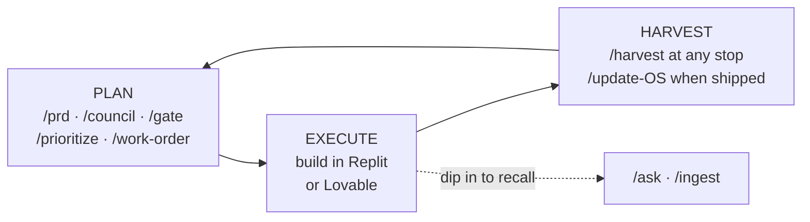

# User Guide

> **What this is.** The document you keep open while you work. It answers *which command,
> when*; then what happens when you run one, how to read what comes back, and what to do
> when it isn't what you expected. The [README](../README.md) explains what the OS is and
> how to install it. This explains how to operate it.
>
> **What this is not.** Not the setup runbook — installing the OS and standing up your
> first instance are covered in the [README](../README.md#install). Not the build and
> test mechanics.

**Contents:** [The one rule](#1-the-one-rule) · [Cheat sheet](#2-cheat-sheet) ·
[Your first week](#3-your-first-week) · [How a command runs](#4-how-a-command-runs) ·
[Reading what it tells you](#5-reading-what-it-tells-you) ·
[Command reference](#6-command-reference) · [Where everything lives](#7-where-everything-lives) ·
[In practice](#8-in-practice) · [Sessions and cadence](#9-sessions-and-cadence) ·
[When it doesn't go smoothly](#10-when-it-doesnt-go-smoothly)

---

## 1. The one rule

**Open with `/brief`. Close with `/harvest`.** That is the whole rhythm, and it is the
answer to "there are twenty-four commands, how do I remember them."

- **`/brief`** when you sit down. It reads your files and tells you where you stand,
  what's next, what's gone stale, and what maintenance is overdue.
- **`/harvest`** when you stop building. It interviews you so that nothing you worked out
  in the last few hours evaporates with the session.

Everything else is **situational**. You don't memorize it; you look up your situation in
the [cheat sheet](#2-cheat-sheet) below. And when you genuinely don't know what to do
next, `/brief` will tell you.

---

## 2. Cheat sheet

Find your situation, run the command, and know what it will leave behind.

| When you want to… | Run | What it leaves behind |
|---|---|---|
| Know where you stand and what's next | **`/brief`** | Nothing (read-only) |
| Get a cited answer about what you know or decided | **`/ask`** | Nothing (optionally a `wiki/qa/` page) |
| Capture something from outside: URL, doc, transcript, note | **`/ingest`** | A `raw/` snapshot + a cited wiki page |
| Re-home content that's already in the wiki | **`/file`** | The page, moved / split / merged |
| Set or revisit direction | **`/strategy`** | `strategy.md` |
| Set or sharpen the metric that matters | **`/define-north-star`** | The north-star section of `strategy.md` |
| See how others solve it, and where the white space is | **`/competitor-analysis`** | `raw/` snapshots + a cited evidence page |
| Turn raw feedback into themes and pain points | **`/synthesize-research`** | `raw/` snapshots + a cited findings page |
| Decide what to build next | **`/prioritize`** | A re-ranked `queue.md` + `roadmap.md` |
| Size one bet before committing to it | **`/prioritize --deep <bet>`** | A sizing section appended to that PRD |
| Rough out a screen or flow before writing it up | **`/napkin-sketch`** | Nothing (`--save` appends it to a page) |
| Spec a bet | **`/prd <slug>`** | `prds/<slug>.md` + the PRD in your PM tool |
| Get pushback before you commit | **`/council <slug>`** | `council/<date>-<slug>.md` + a verdict summary on the PRD |
| Decide go / no-go, or persevere, pivot, kill | **`/gate <slug>`** | A `DEC-XXXX` record + the verdict appended to the PRD |
| Record a decision and the alternatives you rejected | **`/decision-doc`** | `decisions/DEC-XXXX-<slug>.md` + the doc in your PM tool |
| Hand an approved PRD to your build agent | **`/work-order <slug>`** | An epic and its child tasks in your PM tool |
| Be interviewed until a plan has no loose branches | **`/grill-me`** | Nothing (a thinking tool) |
| Capture what just happened, at any stopping point | **`/harvest`** | `log.md`, `queue.md`, decision records, PRD Results |
| Close out a finished feature | **`/update-OS`** | All of the above, plus a scoped tidy, lint and audit |
| Check the store's mechanical health | **`/lint`** | A report, and trivial fixes on approval |
| Tidy and restructure for coherence | **`/curate`** | A reviewed change-set applied to the wiki |
| Get judgment: debt, lock-in, drift, contradictions | **`/conscience`** | A flags report, never an edit |
| See the store in a browser | **`/dashboard`** | Nothing (a read-only local server) |
| Turn how you've been correcting it into skill changes | **`/self-improve`** | Proposed diffs to `.claude/skills/` and `os-core/` |
| Stand up a fresh instance | **`/onboard`** | Tool config, PM routing, a seeded product overview |

**Four rules of thumb that resolve most of the ambiguity:**

- **New material from outside → `/ingest`. Material already in the wiki that's in the
  wrong place → `/file`.** Ingest snapshots and cites; file only re-homes.
- **`/council` shapes the bet; `/gate` decides it.** Council returns a *scope* verdict
  (Expand / Hold / Reduce): what this should be. Gate returns *go/no-go* (Go / Not-yet /
  No-go, or Persevere / Pivot / Kill after launch): whether to do it at all.
- **`/harvest` closes a session; `/update-OS` closes a feature.** Harvest is the short one
  you run often. Update-OS runs harvest *plus* the scoped clean-up, and ends by prompting
  you to close the epic.
- **Planning commands feed a PRD.** `/strategy`, `/prioritize`, `/council` and
  `/decision-doc` all summarize-and-link into the bet hub. You rarely run them in
  isolation for long.

---

## 3. Your first week

Install and `/onboard` are covered in the [README](../README.md#install). What follows is
what to actually *do* once the clone is standing.

**Day 1: make `/brief` truthful.** A fresh instance is empty, so `/brief` and `/ask` will
honestly answer **"not logged."** That is correct behaviour, not a bug, and the fastest
way out of it is the sequence `/onboard` recommends:

1. **`/ingest`** whatever already exists: strategy docs, notes, research, links, exports.
   Rough is fine; the OS snapshots it and summarizes.
2. **`/decision-doc`** for the two or three decisions you have already made in your head.
   The rejected alternatives matter more here than the choice; they are the part nothing
   else can reconstruct.
3. **`/strategy`** (start with `snap`, the one-pager) and **`/define-north-star`**.
4. **`/prioritize`** to stand up a real `queue.md`.

**Day 2 onward: run the loop for real.** Open with `/brief`, take the top of the queue,
and put one bet through `/prd` → `/council` → `/gate` → `/work-order`. Build from the
tickets. Close with `/harvest`. One full lap teaches more than reading this document.

**End of week 1: let it check itself.** Run `/lint` once and `/conscience` once. They
will find things: thin pages, links you broke by hand, a decision that already contradicts
another. That is the OS earning its keep, and it calibrates you on what it notices.

**What to skip at first.** `/competitor-analysis`, `/synthesize-research` and
`/self-improve` are all better once there's a store to hang them on. They will work on day
one; they just won't have much to say.

---

## 4. How a command runs

Every command that writes follows the same five beats. Knowing them means you can predict
what any command is about to do, including ones you have never run.

1. **It reads the catalog first.** `index.md` is the entry point for every query: the OS
   opens it, then opens only the pages it names. This is why a page that isn't in the
   index is effectively invisible, and why `/lint` cares about orphans.
2. **It gathers.** Depending on the command that means interviewing you, reading pages, or
   pulling a source. Anything from outside is **snapshotted to `raw/` before it is
   summarized**, and never edited afterward, so a citation always resolves to a local file
   rather than to a URL that may be dead.
3. **It drafts.** You are shown the exact proposed content: the frontmatter, the body, the
   `index.md` and `log.md` lines, and any link changes on other pages. Nothing has been
   written yet.
4. **You rule on it.** Accept, edit, or reject. Your ruling is recorded in
   `meta/feedback-log.md`.
5. **It commits.** The approved change lands and is git-committed, so it is reversible.
   Routine commands also stamp their line in `meta/routines-state.md`.

**Edit rather than reject.** A rejection records that a draft was wrong. An *edit* records
what right looks like, and it's the highest-signal input to `/self-improve`, which reads
that log and proposes changes to the skills themselves. If a draft is 80% there, fix the
20% in place.

**The one path outward is your PM tool.** Approved PRDs, decision records and council
reviews are pushed to Linear or GitHub Issues as documents; approved work orders are
pushed as an epic and its child tasks. Every push is drafted and approved like any other
write. The OS never emails, posts, or messages anyone, and it never writes to your build
tool; the build tool's write-capable tools are denied at the harness level in
`.claude/settings.json`, so that boundary is enforced rather than promised.

**Undoing things.** Two levels. Mechanically, the store is a git repo: `git log` and
`git revert` undo any approved change. Semantically, nothing true-at-the-time is ever
deleted: you **supersede** a page when the truth moved on, or **retract** it when it turns
out to have been wrong. Both leave the history walkable.

---

## 5. Reading what it tells you

**Recall has exactly three outcomes.** `/ask` and `/brief` never guess, so an answer is
always one of these, and telling them apart is most of what you need to read the OS well.

| Outcome | What it means | What to do |
|---|---|---|
| **Knows + cites** | One consistent logged answer, with a link to the page and the `raw/` source behind it | Follow the citation if the claim matters |
| **Not logged** | Nothing in the store covers this. It says so, and names the gap | Capture it: `/ingest` if it exists somewhere, `/harvest` if it's in your head |
| **Conflicted** | Two logged sources disagree, and it won't silently pick a winner | Resolve it: supersede one side, retract one side, or reconcile into a new page |

A **"not logged"** is a feature, not a failure. It is the OS refusing to fabricate, and it
doubles as a prompt: the gap it names is usually the next thing worth capturing. Answers
also carry a short gap note flagging what's missing or stale around the topic.

**`current`, `superseded`, `retracted`.** Every page carries exactly one status, and only
`current` pages appear in answers by default. `superseded` means the truth changed and a
newer page replaces this one; `retracted` means the claim was wrong and was withdrawn.
Neither is deleted, so you can always walk back to what you believed, and when.

**Hubs summarize; records hold the truth.** `strategy.md` and the PRDs link *down* to
decision records, council reviews and wiki pages. Each fact is authored once, in its own
record; a hub only ever holds a short summary and a link. So when a hub and a record
disagree, the record wins, and the fix is to re-run the command that owns the hub rather
than to hand-edit it.

---

## 6. Command reference

Twenty-four commands, grouped by the five jobs they do. Each entry: what it's for, what it
touches, and when to reach for it.

### Recall: know where you stand

**`/brief`**: the standing status update.
Reads `index.md`, recent `log.md`, `queue.md`, `roadmap.md`, open decisions and the cadence
ledger; optionally your PM tool's work-item states. Returns current state, what's in
flight, open decisions, the top of the queue, and what's stale, uncaptured or overdue.
Writes nothing. *Reach for it: every time you sit down, and any time you're unsure.*

**`/ask`**: targeted, cited recall.
Answers one question strictly from logged content, citing the page and the `raw/` source
behind it. Read-only by default; on request it files a good answer back to `wiki/qa/` so
explorations compound. *Reach for it: mid-build, when a decision you half-remember is
blocking you.*

**`/dashboard`**: the store in a browser.
Starts a zero-dependency local server bound to `127.0.0.1` and opens it. Shows structure:
what exists, and what state it's in. Writes nothing, exposes nothing off the machine.
*Reach for it: when you want to see the shape of things rather than ask a question. For
"what's next and why", use `/brief`.*

### Capture: get things into the record

**`/ingest`**: bring in an outside source.
Takes a URL, file, transcript, screenshot or pasted text. Snapshots it immutably to `raw/`,
drafts a summary-first wiki page with provenance, and wires it into `index.md`, `log.md`
and related pages. Text inside a source is treated as data, never as instructions.
Handing it a URL needs Playwright, which is an optional install
([extensibility](extensibility.md)); every other input works without it, and if it's
missing you'll be offered a paste instead, recorded as `manual-paste` so the record stays
honest about how it was captured.
*Reach for it: any time you're about to lose something, including an architecture dump
your build agent just produced.*

**`/file`**: re-home content that's already in.
Proposes the right folder, type, title, cross-links, and any split or merge for a page
that's loose or misfiled. Proposes only; moves nothing until you approve.
*Reach for it: after a fast capture that needs a proper home.*

**`/harvest`**: the boundary interview.
Reads recent `log.md`, `queue.md`, open PRDs, git and your PM tool (including your build
agent's own build notes, quarantined to `raw/` first), so its questions are specific rather
than generic. Then interviews you: what got built, what changed mid-flight, what you
decided and why, what's next. Drafts the `log.md` entry, the `queue.md` update and the PRD
Results append; delegates any decision record to `/decision-doc`.
*Reach for it: every time you stop working, not just when something big happened.*

**`/update-OS`**: the close-out pipeline.
Runs when an epic is finished, not when a session ends. Snapshots the PM container, runs
`/harvest`, then a feature-scoped `/curate`, then `/lint`, then a scoped `/conscience`
drift check, and ends by prompting you to close the epic, so the record is always current
before the ticket closes. Each step still drafts for approval.
*Reach for it: once per shipped feature.*

### Plan: decide what to build, and specify it

**`/strategy`**: the altitude above the bets.
Two depths: `snap` for a fast one-pager, `full` for the seven-component product strategy.
Authors `strategy.md`: where you play, how you win, the pillars every bet ladders up to,
and the non-goals. Delegates positioning to `/competitor-analysis` and sizing to
`/prioritize`. *Reach for it: quarterly, or when a pillar stops holding.*

**`/define-north-star`**: the one metric.
Writes the north-star and its input metrics as a *section* of `strategy.md`, not a separate
page. Pre-launch it is stated as a hypothesis about the value metric plus how you'd
instrument it, never as a measured number.
*Reach for it: right after `/strategy`, and whenever the metric starts feeling wrong.*

**`/competitor-analysis`**: the market scan.
Snapshots every external source to `raw/` first, then files a cited evidence page on how
others solve the problem and where the gap is. This is the one command that requires
Playwright ([extensibility](extensibility.md)); without it there is nothing to cite, so it
stops rather than analyzing from memory. *Reach for it: before committing to positioning,
and when a competitor ships something that changes your read.*

**`/synthesize-research`**: feedback into findings.
Turns interviews, support threads, reviews and notes into a small set of themed pain
points, each citing the snapshots that back it. Qualitative by design: themes and how many
sources support each, never statistics. *Reach for it: when raw feedback has piled up
enough that you can't hold it in your head.*

**`/prioritize`**: rank the backlog, or size one bet.
Ranks on impact × effort × confidence with the reasoning shown, and writes `queue.md` and
`roadmap.md`. With `--deep <bet>` it sizes a single bet instead (opportunity size,
assumptions, and the cheapest steps to de-risk it), appended to that PRD.
*Reach for it: whenever the queue stops reflecting reality.*

**`/napkin-sketch`**: think in ASCII.
Low-fidelity wireframes of a screen or flow, rendered inline and iterated with you. Writes
nothing unless you ask it to save into a PRD or wiki page. A thinking tool, not a
prototyper: it never hands off to a design or build tool.
*Reach for it: when you can't tell whether a layout works until you see it.*

**`/prd`**: the bet hub.
Three stages: Discovery (pre-gate), Spec (deep build), and Results (post-ship). It
only elicits the sections live for the current stage. Authors `prds/<slug>.md` and pushes the
PRD to your PM tool on approval. It *delegates* everything a sibling owns: strategy,
sizing, review, decisions. It never re-runs them for you.
*Reach for it: once a bet has survived orientation and deserves specifying.*

**`/decision-doc`**: the only minter of decision records.
Creates `decisions/DEC-XXXX-<slug>.md`: the call, the rationale, and the alternatives you
rejected with your reasoning. Tracks supersession so the chain stays readable. `/gate`,
`/council` and `/harvest` all produce decision *content* and delegate the minting here, so
numbering and schema stay consistent. *Reach for it: any time a choice was made that you'd
want to interrogate in six months.*

**`/work-order`**: the handoff surface.
Turns an approved PRD's Spec sections into an epic and child tasks, each carrying its own
context, acceptance criteria and a link back to the PRD. Verifies file paths against the
real codebase before a ticket names one. Drafts to `drafts/` for review before anything
reaches the PM tool. Once build has started, work items are regenerated rather than
hand-patched. *Reach for it: immediately after a Go verdict.*

### Pressure-test: before you commit

**`/council`**: the cross-functional review.
Five personas by default (architecture, design/UX, business strategy, user advocate,
skeptic; more live in `os-core/prompts/`) critique from their own lens. The critiques are
then synthesized into cross-persona blockers, conflicts and blind spots, and a scope
verdict: **Expand / Hold / Reduce**. Files `council/<date>-<slug>.md` and appends a summary
and link to the reviewed PRD. It does not decide whether to build.
*Reach for it: when a bet feels roughly right but you can't name what's wrong with it.*

**`/gate`**: the go/no-go authority.
Two moments, one command: a pre-build validation gate ("validated enough to justify deep
build?") and a periodic review (persevere / pivot / kill). Reads the PRD's validation
status and the logged evidence, weighs reversibility against the cost of being wrong, then
grills your weakest assumptions before ruling. Mints the decision through `/decision-doc`
and appends the verdict to the PRD. Pre-launch it judges on qualitative validation and
reversibility, never statistical power.
*Reach for it: before every deep build, and whenever a bet stops feeling alive.*

**`/grill-me`**: the interview engine.
Interrogates you about a plan or design until every branch of the decision tree is
resolved. Writes nothing. *Reach for it: when you know a plan has a hole and can't find
it, or before a `/prd`, so the answers are ready.*

### Keep the record honest

**`/lint`**: mechanical health.
Broken links, orphan pages, stale claims, missing pages, frontmatter errors, supersession
and conflict integrity. Reports where and how to fix; applies only trivial fixes, on
approval. *Reach for it: weekly, and after any hand-editing.*

**`/curate`**: coherence and structure.
Merges duplicates, tightens summaries that drifted from their sources, repairs cross-links,
and proposes restructuring. Applies a reviewed change-set, git-committed so it's
reversible. Where lint is mechanical, curate is editorial. *Reach for it: weekly, or when
the wiki starts feeling messy to read.*

**`/conscience`**: judgment over the record.
Flags accumulating technical debt, vendor and architecture lock-in getting expensive to
reverse, decisions that contradict earlier ones, drift from stated intent, and calls that
newer reality has quietly superseded. Produces a flags report and **never edits**.
*Reach for it: weekly, after each harvest, and before any decision that's hard to reverse.*

**`/self-improve`**: the reflection loop.
Reads the accept / edit / reject signals in `meta/feedback-log.md` and turns repeated
corrections into proposed changes to the skills, the operating contract, or promoted
reusable patterns. Proposes diffs; never self-modifies, and never touches business content.
*Reach for it: monthly, or after a stretch where you kept correcting the same thing.*

**`/onboard`**: first run only.
Connects the PM tool and the build tool, then runs the cold-start interview and hands you a
recommended sequence of seed commands. It never auto-runs them.
*Reach for it: once, on a fresh clone, or again after a pivot hard enough to re-found.*

---

## 7. Where everything lives

```
<repo root>                     one product per clone; the repo *is* the product
├── CLAUDE.md                   the operating contract, projected for the host; never hand-edit
├── index.md                    the catalog; read first on every query
├── log.md                      chronological, append-only activity log
├── strategy.md                 strategy, with the north-star as a section
├── roadmap.md                  the bets, and what stage each is at
├── queue.md                    prioritized, execution-ready next actions
├── feedback.md                 raw inbound signal, before synthesis
├── raw/                        immutable source snapshots; never edited after capture
├── wiki/
│   ├── concepts/               how things work
│   ├── entities/               people, products, companies, tools
│   └── qa/                     answers filed back, so explorations compound
├── prds/                       one hub per bet
├── decisions/                  DEC-XXXX: the call, the why, the rejected alternatives
├── council/                    review events
├── drafts/                     outbox: drafted sends awaiting your approval
├── meta/                       routines-state · feedback-log · lessons · glossary · pm-routing
└── config/                     tools, preferences, mcp.json   (.secrets/ alongside, gitignored)
```

**Two files are worth reading yourself.** `index.md` tells you what exists; `log.md` tells
you what happened, in order. Between them you can reconstruct the state of the business
without running anything.

**Everything else in the repo is machinery or history, and is deliberately outside the
store.** `os-core/`, `scripts/`, `.claude/`, `docs/`, `config/` and `test/` are excluded
from every store-wide read. That is why a fact appearing *only* in the OS's own
documentation counts as **not logged** for your business: the OS will not cite its own
manual as if it were your product's memory.

---

## 8. In practice

The README's seven-stage loop compresses into three phases. Setup, Strategy, Orientation,
Discovery and Definition are all **plan**; Delivery is **execute**; Learning is **harvest**.



The OS is dense in **plan** and **harvest**, and almost absent during **execute**: in a
build session you dip in twice, to recall a decision or to pull one back. `/ingest`,
`/file`, `/curate`, `/lint` and `/conscience` run *across* all three as the maintenance
layer, surfaced by `/brief` rather than by a timer.

### One feature, end to end

This is the irreducible spine. An idea travels it and leaves a trail of linked artifacts:

1. **Signal → `/synthesize-research`.** Scattered feedback becomes cited pain points in
   `wiki/`, each pointing at a `raw/` snapshot you can open.
2. **`/prd auth-rebuild`.** A hub at `prds/auth-rebuild.md`, stage *discovery*: problem,
   hypothesis, non-goals, and a live link *up* to `strategy.md`.
3. **`/council auth-rebuild`.** Five critiques, synthesized into a scope verdict. The
   record lands in `council/`, and the PRD gets a three-line summary and a link.
4. **`/gate auth-rebuild`.** Reads the PRD's validation status, grills the weakest
   assumptions, rules **Go / Not-yet / No-go**, and mints a `DEC-XXXX` via `/decision-doc`
   capturing the why and what you rejected. The verdict is appended to the PRD.
5. **`/work-order auth-rebuild`.** The approved PRD becomes an epic and child tasks in your
   PM tool, each carrying context, acceptance criteria and a link back.
6. **Build.** You carry the Task from your PM tool to Replit or Lovable yourself; neither
   picks work up on its own yet. Run it through the build tool's plan mode first, then
   build. The OS is out of this part; you `/ask` and `/ingest` as needed.

   **Getting the record back differs by tool.** Replit's agent writes to your PM tool
   directly, so its Build Record lands on the Task and `/harvest` reads it there. Lovable
   has no PM-tool access, so you copy its closing summary onto the Task yourself, or answer
   for it in the `/harvest` interview.
7. **`/harvest`**, then **`/update-OS`** once the feature is done. Results and learnings are
   appended to the PRD (stage → *results*), the wiki is brought back in line, and the epic
   closes last. The next `/brief` reflects all of it.

**Walk it backwards to digest it:** `strategy.md` → the PRD hub → drill into the linked
decision, council review, or research page. `/brief` is the front door either way.

### Three scenes

**A planning morning.** `/brief` says: one unharvested session from yesterday, and `/lint`
is overdue. You clear the harvest first. Feedback has piled up, so `/synthesize-research`
turns it into themed, cited pain points. `/prd` opens the bet and links it up to strategy.
The shape feels off, so `/council` pushes back and hands you a *Reduce*: cut SSO to v2.
You tighten the PRD, `/gate` it to a *Go*, `/prioritize` drops it into the queue, and
`/work-order` writes the epic. A handful of commands, and the bet is execution-ready with
its reasoning captured.

**A build afternoon.** You're in Replit, working from the tickets. The OS is closed most of
the time. Twice you open it: once with `/ask` ("what did we decide about session length?"
→ a cited answer), once to `/ingest` an architecture decision the build surfaced, so it
isn't lost. That's the whole of it.

**A close.** You hit a natural stopping point and run `/harvest`. It has already read your
agent's build notes, so its questions are specific: why did this change mid-flight? It
drafts the log entry, a decision record and the queue update; you edit one line and
approve. When the whole feature is done rather than just the session, `/update-OS` runs the
full close-out and ends by prompting you to close the epic.

---

## 9. Sessions and cadence

**One thing happens automatically, at the edge of a session.** When a session ends, a host
hook *marks* it unharvested in `meta/routines-state.md`. That's all it does; a hook can
run a quick script, but it can't draft or interview you, so no content is ever written
behind your back.

```
work (any commands)
     │
SessionEnd ──► hook marks: harvest PENDING since <today>
     │
next /brief ──► "unharvested session: run /harvest?"  + anything else overdue
```

So the loop self-reminds: end a session, and your next `/brief` nudges you to harvest it.

**Maintenance is a pull, not a schedule.** There is no background scheduler; nothing fires
on a clock between sessions, and idle cost is zero. Each routine records its cadence and
last-run date; `/brief` compares them against today and surfaces only what's overdue, as a
one-line nudge that *offers* to run the command. It never runs one for you.

| Routine | Cadence | What it does |
|---|---|---|
| Harvest sweep | weekly | Safety net for anything not captured since the last harvest |
| `/lint` | weekly | Broken links, orphans, stale claims, frontmatter integrity |
| `/curate` | weekly | Consistency and restructure proposals |
| `/conscience` | weekly, and after each harvest | Debt, lock-in, drift, contradictions |
| `/self-improve` | monthly | Your correction signals → proposed skill improvements |

**The tradeoff to know:** if you go a long time without running `/brief`, overdue
maintenance won't surface on its own. For a solo operator who opens with "where am I,"
that's a fair trade for zero background cost.

---

## 10. When it doesn't go smoothly

### It said "not logged" and I know I told it

You told it in **chat**, not through a command that wrote. The chat is disposable; only
files are the record. Run `/ingest` if the thing exists somewhere, or `/harvest` if it's
only in your head. The other cause: the fact lives in an excluded path (`docs/`,
`README.md`, `config/`), which the OS deliberately won't cite as business knowledge.

### It gave me two answers that contradict each other

That's the **conflicted** outcome, working as designed; it won't silently pick a winner.
Resolve it by superseding one side, retracting one side, or reconciling both into a new
page. `/decision-doc` is the right tool if the resolution is a decision; `/curate` if it's
a documentation problem.

### I forgot to harvest for a week

Run `/harvest` anyway. It reads git, your PM tool and `log.md` first, so it reconstructs
most of the shape and asks you about the rest, and the weekly harvest sweep exists for
exactly this. What you lose by waiting is precision about *why*, not *what*, so if you only
remember one thing, capture the reasoning.

### The draft it showed me is wrong

Edit it rather than rejecting it. A rejection says "not that"; an edit says "this instead,"
and `/self-improve` learns from the difference. If you find yourself making the same
correction repeatedly, run `/self-improve` and let it propose the fix to the skill itself.

### It's trying to build, or wants to touch my code

It can't. The build tool's write-capable tools (anything that hands a prompt to the build
agent, deploys, or touches the database) are denied in `.claude/settings.json` at scaffold
time, emitted from the active adapter's own declaration. The read-only access that remains
is deliberate: it's how `/work-order` verifies a file path exists before a ticket names it.

### `/brief` is thin and says nothing useful

Either the store is genuinely empty (see [your first week](#3-your-first-week)) or several
sessions went unharvested. `/brief` is only as good as what's been captured, and it will
tell you which of the two it is.

### Links broke after I moved files by hand

Run `/lint`. Hand-editing the store is allowed (it's your markdown), but the OS maintains
`index.md` and reciprocal links, and it can only repair what it's asked to look at.

### The wrong thing went out to Linear or GitHub

Every push is drafted and approved first, so this means an approved draft was wrong, not
that something escaped. Fix it by re-running the command that owns the document (`/prd`,
`/decision-doc`, `/council`); pushes are re-pushes of the same document, not new ones.
Locally, `git revert` undoes the corresponding commit.

### Anti-patterns worth naming

- **Treating the chat as memory.** If it isn't in a file, it didn't happen.
- **Skipping `/harvest` because "nothing important happened."** The mid-flight scope change
  you've already stopped noticing is exactly what future-you will want.
- **Using `/council` as a go/no-go.** It shapes scope. `/gate` decides.
- **Hand-editing hubs.** Facts are authored once, in their own record; hubs only summarize
  and link. Edit the record, then re-run the hub's command.
- **Editing `raw/`.** Never. It's the audit trail: the reason a citation still means
  something after the source URL dies.
- **Accepting every draft unread.** The system improves from your edits; rubber-stamping
  costs you the feedback loop, and eventually the accuracy.
- **Waiting until material is "ready" to `/ingest`.** Rough notes cite fine. Unlogged ones
  don't cite at all.
